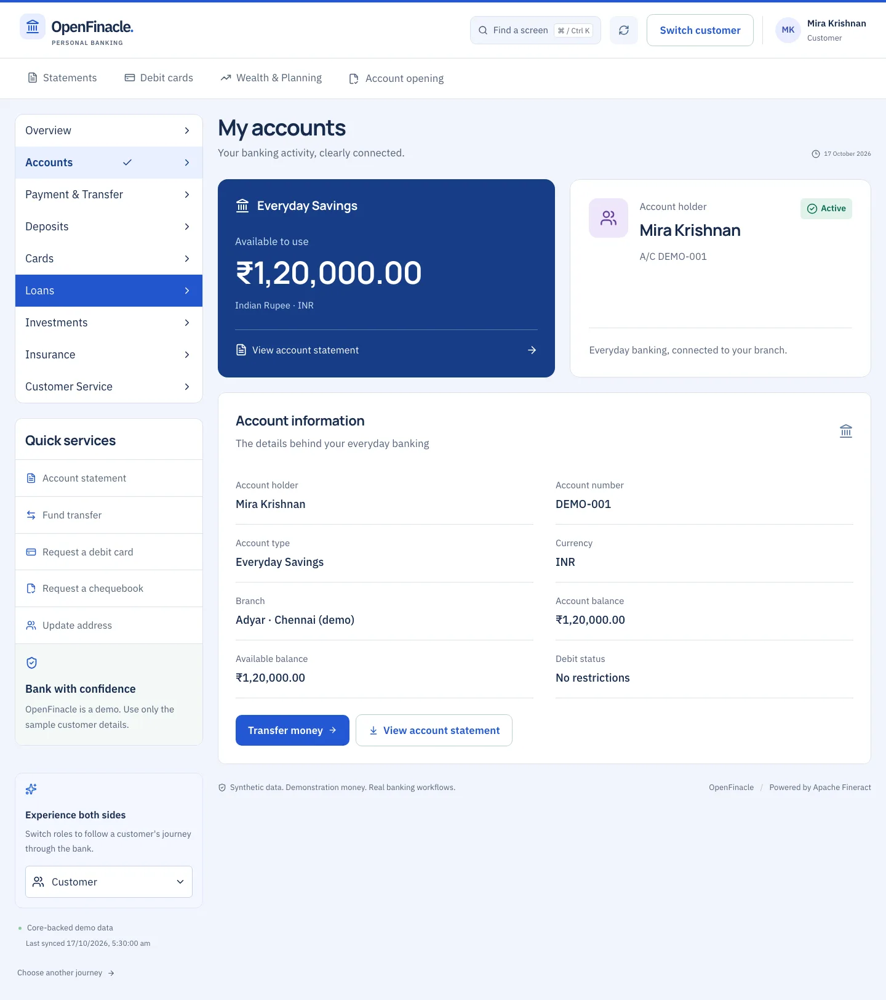
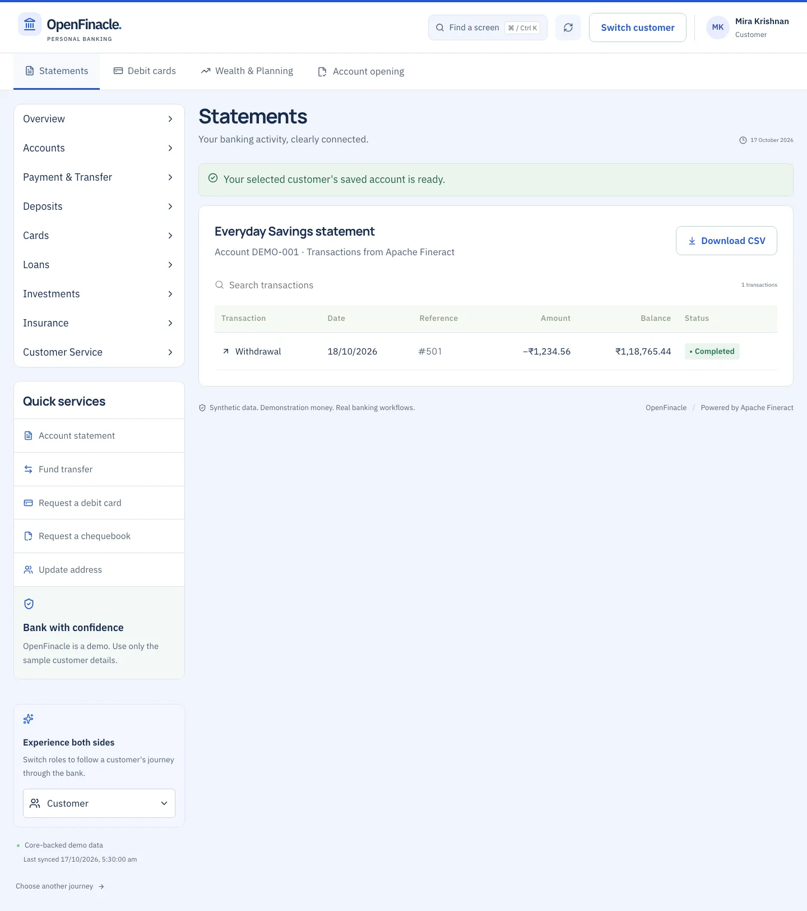
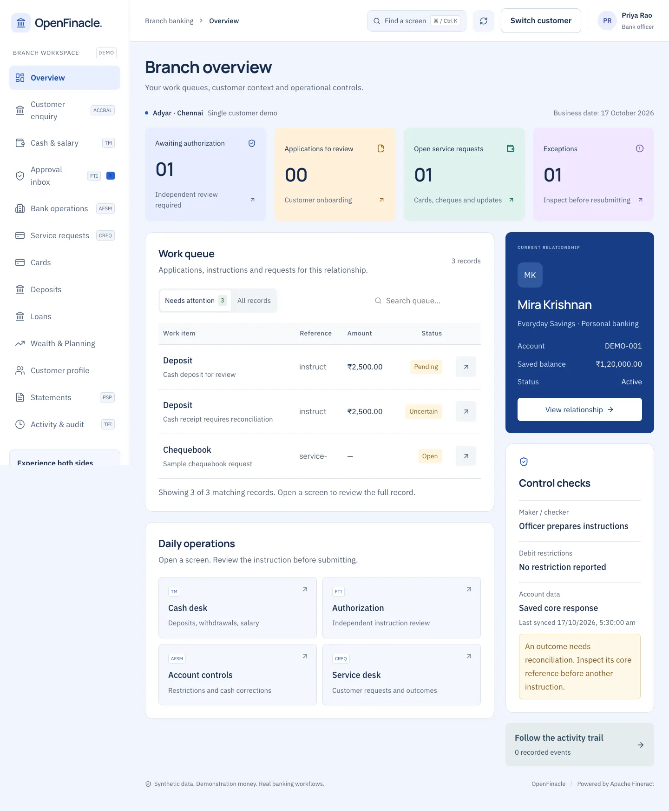
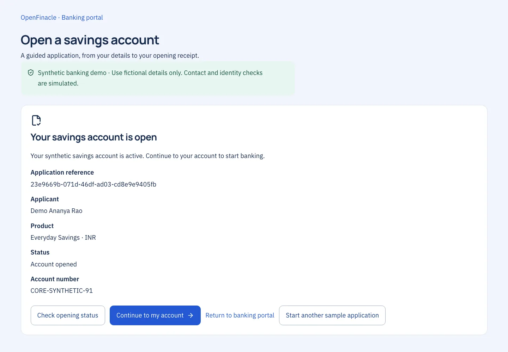
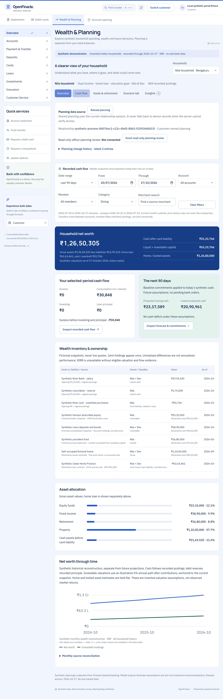
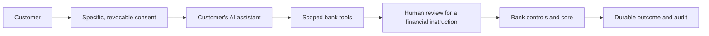

# OpenFinacle

**Banking, seen from both sides.** OpenFinacle is a working retail-banking prototype that connects a customer's everyday money journey with the branch team behind it. This repository contains the customer portal, staff workflows and integration with Apache Fineract, using persistent synthetic customers and demonstration money.

[Explore the product](https://openfinacle.plts.in/discover) · [Try the demo](https://openfinacle.plts.in/demo) · [Capabilities](https://openfinacle.plts.in/capabilities) · [Roadmap](https://openfinacle.plts.in/roadmap) · [Finacle, the inspiration](https://www.finacle.com/solution/core-banking-solution/)

[MIT license](LICENSE) · [Contributing](CONTRIBUTING.md) · [Security](SECURITY.md) · [Third-party notices](THIRD_PARTY_NOTICES.md)

<a href="https://openfinacle.plts.in/discover"></a>

*An actual acceptance-fixture screenshot. Names, balances and transactions are sample data; the image is not a live account view.*

## Why We Built It

Banking is a connected story: opening an account, receiving a salary, paying someone, asking for help and planning for the future. Customers and branch teams see different parts of that story. OpenFinacle explores how those viewpoints can work together in a clear, usable experience.

The project also asks a practical question: how far can a founder working with AI coding tools get when building on an established open-source banking core? The result is something to inspect and try, with explicit distinctions between working financial journeys, simulated product workflows and future ideas.

**Our vision:** banking that people—and the AI assistants they choose—can understand and navigate, with clear permission and visible outcomes.

**Our mission:** make connected banking journeys tangible, test their behaviour against a real core, and show the engineering and operational work still needed for adoption by a bank.

## What You Can Explore Today

| Capability | What works in the prototype | Boundary |
| --- | --- | --- |
| Customer relationships | Choose from a persistent synthetic customer directory; return to the selected customer's account and history | Demo sessions and persona switching, not production identity |
| Account opening | Staged application, saved progress, synthetic documents and an independently opened relationship | No real KYC, identity verification or external onboarding checks |
| Savings and statements | Core account enquiry, transaction history and statement export | Selected INR savings journeys |
| Payees and transfers | Customer-specific saved payees, reviewed transfers and genuine debit/credit records in Fineract | Internal transfers between registered demo accounts; no external payment rails |
| Branch operations | Officer and independent approver viewpoints, teller cash journeys, queues and audit | Maker/checker is enforced by the application over a technical Core principal |
| Deposits, cards and service | Persistent fixed/recurring deposit models, debit-card controls, replacement requests, profile and service histories | Simulated products and fulfilment; no investment of funds, card network or physical dispatch |
| Personal lending | Selected loan-origination and savings-funded repayment pilot | Broader servicing, collections and product coverage remain incomplete |
| Wealth & Planning | Synthetic household cash flow, budgets, goals, retirement projections, saved scenarios and consented adviser review | No regulated advice, market execution or custody |
| Navigation and accessibility | Readable bookmarked routes for menus and sections, browser history, keyboard controls and responsive layouts | Opening a link retains the saved session; it does not select a customer or grant a role |

Fineract owns financial balances and postings. The application keeps workflow records, simulated product records and planning models separately. An uncertain financial outcome stays inspectable under its original reference; the application does not silently send the instruction again.

## A Look Inside

These are the same synthetic acceptance-fixture images used on the product website. Click an image to inspect it at full resolution.

| Customer statement | Branch workspace |
| --- | --- |
| [](public/product/statements.webp) | [](public/product/branch.webp) |

<details>
<summary><strong>See account opening and household planning</strong></summary>

### Account Opening

[](public/product/onboarding.webp)

### Wealth & Planning

[](public/product/planning.webp)

</details>

## Try a Connected Journey

Start at the [demo chooser](https://openfinacle.plts.in/demo). Use invented details only; customers and demonstration records persist between visits.

1. **Meet an existing customer.** Choose a customer explicitly, inspect their [accounts](https://openfinacle.plts.in/accounts) and [statements](https://openfinacle.plts.in/statements), and explore their saved payees.
2. **Follow a payment.** Review an internal [transfer](https://openfinacle.plts.in/payments/transfer), inspect its receipt, then switch to the recipient to see the other side. Confirming a transfer changes persistent demonstration balances.
3. **Start a new relationship.** Try [staged account opening](https://openfinacle.plts.in/open-account) and follow the saved application into its own customer workspace.
4. **Cross the counter.** Use the demo persona control to explore the officer and approver viewpoints. Teller cash operations require separate maker/checker decisions.
5. **Look beyond today's balance.** Explore [planning cash flow](https://openfinacle.plts.in/wealth-planning/cash-flow), goals and saved scenarios. These use a separate synthetic household model.

Direct banking links resume the current saved session or ask you to enter the demo. Staff links require an appropriate demo persona. Unsupported menu items explain their status rather than pretending to perform a banking service.

## From Prototype to a Bank-Owned System

The roadmap is a direction, not a delivery commitment. The [production-readiness assessment](https://openfinacle.plts.in/assessment#readiness) explains the gaps in more detail.

| Workstream | Next evidence needed |
| --- | --- |
| Reliable everyday journeys | Measured latency, stronger operational reconciliation, clear exception handling and broader acceptance coverage |
| Production identity and compliance | Bank-approved customer/staff identity, access controls, KYC/AML and jurisdiction-specific integrations |
| Payments and operations | External rails, settlement, reconciliation, fraud controls, dispute handling and operating procedures |
| Resilience and assurance | Independent security review, load and recovery testing, observability, service objectives and a support team |
| Bank rollout | Product-rule validation, migration rehearsals, data governance, independent bank acceptance and a controlled pilot |
| Broader wealth services | Market data, suitability/advice controls, execution, custody, settlement and reconciliation |
| Banking AI chatbot | Grounded answers, privacy boundaries, evaluation and human escalation; proposed, not implemented |
| Customer AI / MCP access | Scoped, revocable access for a customer's own AI harness, with explicit confirmation before financial instructions; proposed, not implemented |

The agent-connected vision starts with the customer's control:



*This diagram describes a proposed direction. The customer-facing chatbot and MCP service do not exist in the current prototype.*

## The Build Story

Created by **SenG with AI assistance**, reusing the capabilities of Apache Fineract and the wider open-source ecosystem. SenG reports roughly **one week and 500 million tokens** to reach this stage. That is a founder-reported account of the prototype build, not independently measured effort or the cost of developing the underlying core.

The [build story and interactive estimator](https://openfinacle.plts.in/build-story) explore team composition, scope, human effort and AI usage. Estimates are scenarios with assumptions, not observed delivery results, a promise of production readiness or a percentage of Finacle rebuilt. Token volume alone does not measure engineering quality, speed or bank acceptance.

## Inspiration and Credits

- **[Infosys Finacle](https://www.finacle.com/solution/core-banking-solution/)** is a product inspiration and public reference for connected banking capabilities. Finacle has a much broader product and operating scope. OpenFinacle is an independent prototype and working name, with no affiliation, endorsement or product-equivalence claim.
- **[Apache Fineract](https://fineract.apache.org/)** is the banking engine actually used here. The project builds version **1.15.0** from the official distribution; upstream source, licensing and notices remain applicable. See the [core decision](specs/decisions/001-banking-core.md) and [container build](infrastructure/fineract/Dockerfile).
- **[PhotoCraft](https://github.com/storytold/photocraft)** is a reference for the broader idea of exploring familiar software through an independent implementation. It is not an Adobe project or a banking dependency.
- **Next.js, React, Effect, Radix UI, Lucide and the Cloudflare platform** provide application and interface foundations. PostgreSQL persists the Fineract databases.

The [detailed assessment](https://openfinacle.plts.in/assessment) links capability evidence and public sources. Comparisons distinguish selected prototype journeys from commercial core, digital banking and wealth product suites.

## For Developers

The stack separates the experience, workflow orchestration and financial system of record:

| Layer | Responsibility |
| --- | --- |
| Next.js / React | Customer, staff and product experiences, exported as static assets |
| Effect / Cloudflare Workers | APIs, ownership checks, approval workflows, command recovery and Core adapters |
| Apache Fineract / Cloudflare Containers | Financial accounts, postings and banking calculations for supported journeys |
| PostgreSQL | Persistent Fineract tenant registry and banking database |
| Cloudflare D1 / R2 | Application workflow/audit records and private synthetic documents |

```sh
bun install --frozen-lockfile
bun run dev       # UI at http://localhost:3048
bun run check     # Types, lint, static analysis, tests, export and Worker dry run
```

The local Next.js server provides the UI; it does not provide the banking API by itself. The full check requires Docker for the container dry run and SQLite 3.38+ with safe-mode and JSON support. CI installs the SQLite verifier explicitly.

Browser tests use `bun run test:e2e`; read the relevant [Playwright projects and configuration](playwright.config.ts) first. Live financial acceptance tests can create persistent synthetic records and should run only against the intended authorised sandbox. `BASE_URL` selects a different target.

Deployment uses the repository-owned `bun run deploy` CLI. Schema changes require the [protected backup, restore-verification and migration workflow](docs/workflow-release.md). Application rollback must preserve financial records and additive schema; it is not a data reset. Provider credentials belong in protected runtime configuration, never source control.

| Need | Start here |
| --- | --- |
| Domain ownership and executable quality rules | [Domain architecture](docs/architecture.md) |
| Core architecture, bootstrap and recovery | [Development and operations](docs/development-and-operations.md) |
| Financial Core choice and boundaries | [Banking Core decision](specs/decisions/001-banking-core.md) |
| Capability interpretation | [Capability map](docs/capabilities.md) |
| Live acceptance history | [Verification records](docs/verification.md) |
| Releases and workflow migrations | [Workflow release guide](docs/workflow-release.md) |
| Monitoring and telemetry | [Observability](docs/observability.md) |
| Bookmarkable screens | [Friendly route specification](specs/012-friendly-routes/spec.md) |
| Feature intent and contracts | [Specifications](specs/) |

## License and Contributions

The original application code and documentation are available under the [MIT license](LICENSE). Fineract, fonts and other dependencies retain their own licenses and notices; see [third-party attribution](THIRD_PARTY_NOTICES.md). The application remains a prototype using synthetic data, rather than a production-ready banking system.

Contributions are welcome through focused issues and pull requests. The [contribution guide](CONTRIBUTING.md) explains local setup, safe fixture tests, validation and deployment boundaries. Report vulnerabilities privately using the [security policy](SECURITY.md). The package's `private` flag prevents accidental npm publication; it does not restrict the source license or set GitHub repository visibility.
